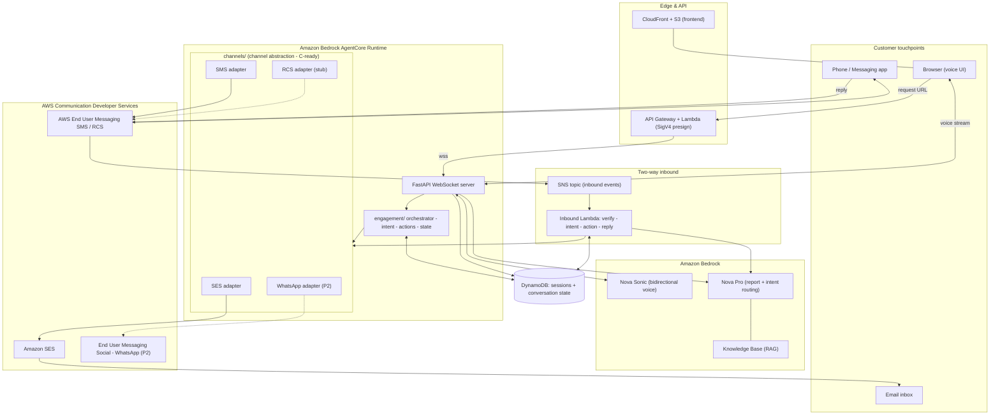

# Architecture Diagram — CDS Agentic Omnichannel Engagement

AWS Communication Developer Services (SES, End User Messaging SMS/RCS, End User
Messaging Social/WhatsApp) are the communications backbone; Amazon Bedrock
(Nova Sonic + Nova Pro) provides the agentic reasoning. Render the Mermaid below
with any Mermaid viewer, or see `ARCHITECTURE.md` for the service breakdown.

